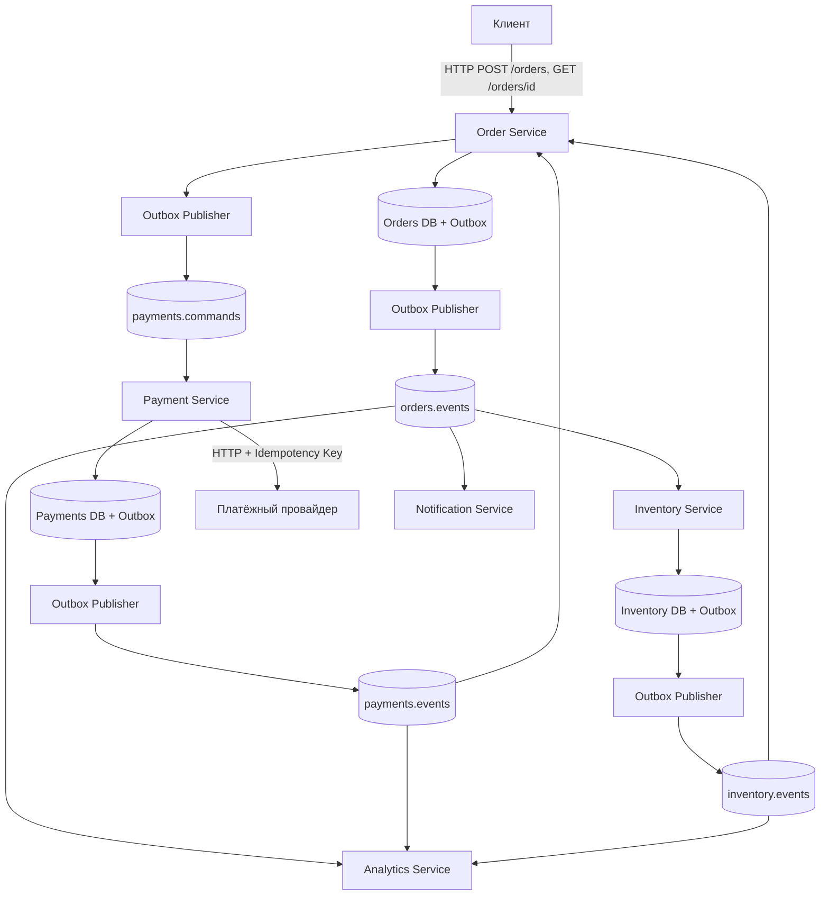
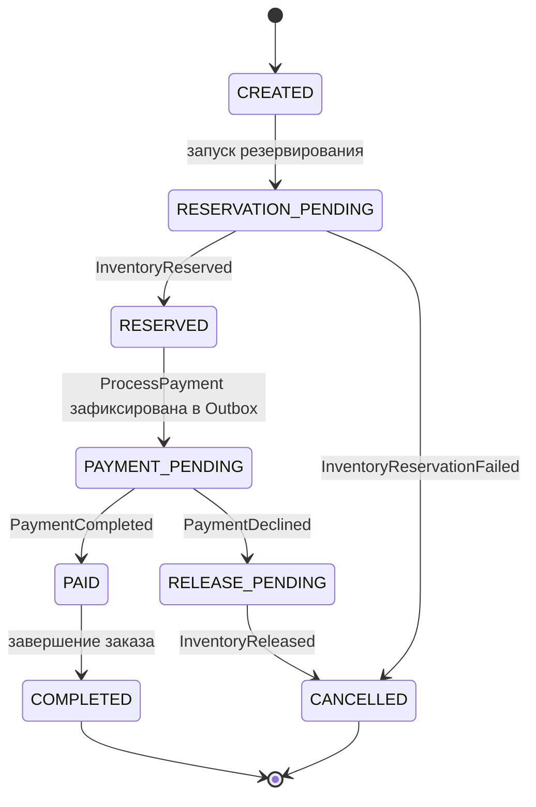

# Event-Driven Commerce — Architecture v1

**Статус:** учебная архитектурная спецификация, версия 1  
**Проект:** `kafka-event-driven-commerce`  
**Основание:** результаты практики модуля 1 курса Apache Kafka  
**Последнее обновление:** 2026-11-03

> Документ фиксирует согласованную концепцию системы и учебные допущения. Это не готовая production-конфигурация. По мере освоения Kafka, PostgreSQL и интеграционных паттернов спецификация будет уточняться.

## 1. Цель и бизнес-требования

Спроектировать интернет-магазин, в котором создание заказа, резервирование товара, проведение платежа, уведомления и аналитика выполняются отдельными сервисами. Для пользовательских запросов применяется HTTP; для межсервисного обмена бизнес-событиями и асинхронными командами — Apache Kafka.

**Зафиксированное бизнес-решение:** сначала **резервирование товара**, затем **платёж**. Платёж нельзя инициировать только по факту `OrderCreated`.

| ID | Требование |
|---|---|
| R1 | Заказ, создание которого подтверждено пользователю, надёжно зафиксирован в БД. |
| R2 | Повторы запросов и событий не приводят к повторному списанию денег. |
| R3 | Недоступность Notification Service не блокирует создание заказа. |
| R4 | Analytics Service может отставать от потока событий до 24 часов и догонять его после восстановления. |
| R5 | Отказ одного Kafka Broker не приводит к потере надёжно подтверждённых сообщений при заявленных настройках репликации и исправном состоянии оставшихся ISR. |
| R6 | События одного заказа обрабатываются с проверкой причинно-следственной последовательности и допустимых переходов состояния. |
| R7 | Consumers выдерживают повторную доставку событий и команд. |
| R8 | Order Service не сообщает `PAID` до получения и фиксации достоверного подтверждения платежа. |
| R9 | Ошибки и неизвестные версии контрактов не приводят к бесконечному циклу без диагностики. |

## 2. Сервисы и ответственность

| Сервис | Основная ответственность | Собственные данные |
|---|---|---|
| **Order Service** | HTTP API заказов; жизненный цикл заказа; оркестрация резервирования, оплаты и компенсаций | Заказы, состояния процесса, Outbox, обработанные события |
| **Inventory Service** | Резервирование товара и освобождение резерва | Остатки, резервы, Outbox, обработанные команды |
| **Payment Service** | Взаимодействие с внешним платёжным провайдером; защита от повторного списания; сверка статуса платежа | Платежи, idempotency keys, Outbox, обработанные команды |
| **Notification Service** | Асинхронная отправка email/уведомлений | Статусы отправки и ключи дедупликации |
| **Analytics Service** | Построение статистики на основе потока событий | Аналитические проекции и прогресс обработки |

У каждого сервиса своё хранилище или чётко изолированная схема; непосредственное изменение таблиц другого сервиса запрещено. Состояние заказа и состояние платежа могут временно различаться из-за асинхронности.

## 3. Архитектура и коммуникации



*Схема концептуальная:* один и тот же Order Outbox Publisher может публиковать в несколько Topics. Команда освобождения резерва направляется в `inventory.commands`; для компактности эта ветка не показана на верхней диаграмме. Notification Service реагирует на `OrderCompleted` и `OrderCancelled`, а не на произвольное создание заказа. Непосредственное изменение чужих БД не допускается.

### 3.1. Протоколы и семантика

- `POST /orders` — создаёт заказ и Outbox-запись в **одной транзакции PostgreSQL**. После успешного commit API может вернуть `201 Created` и состояние `PENDING`/`CREATED`; успешный платёж этим не подтверждается.
- `GET /orders/{orderId}` — возвращает сохранённое состояние Order Service; это может быть промежуточный статус.
- `OrderCreated` — доменное событие; Inventory Service инициирует резервирование; Analytics Service может читать его независимо.
- `InventoryReserved` — результат резервирования; Order Service проверяет состояние и инициирует `ProcessPayment`.
- `ProcessPayment` — **команда** конкретному логическому обработчику Payment Service, не утверждение об успешном платеже.
- `PaymentCompleted` / `PaymentDeclined` — события с достоверным результатом, которые обрабатывает Order Service.
- `ReleaseInventory` — компенсирующая команда; `InventoryReleased` — подтверждающее событие.
- `OrderCompleted` / `OrderCancelled` — события о конечных состояниях; ими пользуются Notification и Analytics.

## 4. Kafka Topics и Consumer Groups

### 4.1. Предлагаемая схема

| Topic | Типы записей | Producer | Consumer Group(s) | Kafka Key |
|---|---|---|---|---|
| `orders.events` | `OrderCreated`, `OrderCompleted`, `OrderCancelled` | Order Service | `inventory-group`, `notification-group`, `analytics-orders-group` | `order_id` |
| `inventory.events` | `InventoryReserved`, `InventoryReservationFailed`, `InventoryReleased` | Inventory Service | `order-orchestrator-inventory-group`, `analytics-inventory-group` | `order_id` |
| `inventory.commands` | `ReleaseInventory` | Order Service | `inventory-commands-group` | `order_id` |
| `payments.commands` | `ProcessPayment` | Order Service | `payment-commands-group` | `order_id` |
| `payments.events` | `PaymentCompleted`, `PaymentDeclined` | Payment Service | `order-orchestrator-payments-group`, `analytics-payments-group` | `order_id` |

Группы названы по **логической функции**, а не по отдельному экземпляру Java-процесса. Несколько экземпляров одной группы совместно обрабатывают её назначенные партиции. Разные группы читают записи независимо.

### 4.2. Учебные параметры

| Параметр | Значение | Обоснование |
|---|---|---|
| Kafka Brokers | 3 | Учебный анализ отказа одного Broker |
| Partitions для перечисленных Topics | 3 (первоначальное допущение) | Возможность параллельной обработки; реальное число определяется замерами нагрузки |
| `replication.factor` | 3 | Три копии каждой партиции на трёх подходящих брокерах |
| `min.insync.replicas` | 2 | Не подтверждать запись при недостаточном числе синхронизированных реплик |
| Producer `acks` | `all` | Подтверждение на условиях ISR и настроек Topic |
| Retention бизнес-событий | Не менее 7 дней в учебной конфигурации | Позволяет Analytics восстановиться после 24 часов простоя при достаточном запасе; фактический срок нужно согласовать с SLA и ёмкостью |

**Ограничения:** после изменения количества партиций соответствие `order_id → partition` может измениться. Старые события не перераспределяются автоматически; порядок между старыми и новыми партициями одного заказа не гарантируется. Kafka также не обеспечивает общего порядка между разными Topics независимо от совпадающего Key.

**Отказоустойчивость:** при `RF=3`, `min.insync.replicas=2`, `acks=all` отказ одного Broker обычно позволяет продолжать запись, если две оставшиеся реплики находятся в ISR и кластер способен выбрать/сохранить лидера. После отказа второго Broker и при единственной доступной ISR-реплике запись на этих условиях успешно подтверждаться не должна. Отказ контроллерного quorum рассматривается отдельно.

## 5. Контракты событий

### 5.1. Перечень

| Сообщение | Вид | Producer | Условие появления | Основные обработчики |
|---|---|---|---|---|
| `OrderCreated` | Event | Order Service | Заказ и его Outbox-запись зафиксированы | Inventory, Analytics |
| `InventoryReserved` | Event | Inventory Service | Резерв успешно зафиксирован | Order Service |
| `InventoryReservationFailed` | Event | Inventory Service | Резерв не удалось создать | Order Service |
| `ProcessPayment` | Command | Order Service | Подтверждено резервирование и разрешён переход к оплате | Payment Service |
| `PaymentCompleted` | Event | Payment Service | Получен и устойчиво сохранён успешный результат платежа | Order Service, Analytics |
| `PaymentDeclined` | Event | Payment Service | Платёж достоверно отклонён | Order Service |
| `ReleaseInventory` | Command | Order Service | Требуется компенсация после неудачной оплаты | Inventory Service |
| `InventoryReleased` | Event | Inventory Service | Резерв освобождён | Order Service |
| `OrderCancelled` | Event | Order Service | Отмена завершена, необходимые компенсации подтверждены | Notification, Analytics |
| `OrderCompleted` | Event | Order Service | Обязательные этапы заказа завершены | Notification, Analytics |

Возможны дополнительные события `InventoryReleaseFailed`, `PaymentStatusUnknown` и `PaymentRefunded` — их контракты уточним при реализации.

### 5.2. Пример JSON: `OrderCreated`

Kafka Key: `"101"` (строковое представление `order_id`).

```json
{
  "event_id": "evt-1001",
  "event_type": "OrderCreated",
  "event_version": 1,
  "occurred_at": "2026-11-03T12:00:00Z",
  "correlation_id": "checkout-500",
  "data": {
    "order_id": 101,
    "customer_id": 50,
    "amount_minor": 159900,
    "currency": "RUB",
    "items": [
      {"product_id": 501, "quantity": 2},
      {"product_id": 703, "quantity": 1}
    ]
  }
}
```

- `event_id`: уникальная идентичность сообщения для дедупликации.
- `event_type` и `event_version`: тип и поддерживаемая версия контракта.
- `occurred_at`: время возникновения события; **не заменяет** причинно-следственную проверку состояний.
- `correlation_id`: связывает сообщения одного бизнес-процесса.
- `amount_minor` + `currency`: сумма в минимальных единицах валюты без `double`.
- `items`: конкретные позиции заказа для резервирования.
- Для команд платежа нужны устойчивые `payment_id` / `idempotency_key`, одинаковые во всех повторах одной логической операции.

Некорректный JSON, неизвестная версия и нарушение бизнес-инвариантов должны обрабатываться раздельно. Неизвестная версия не должна автоматически преобразовываться в «похожую» поддерживаемую версию.

## 6. Жизненный цикл заказа

Order Service выполняет роль оркестратора. Принятый порядок: **создать заказ → зарезервировать товар → провести платёж → завершить заказ**.



### 6.1. Таблица переходов

| Состояние | Вход | Новое состояние | Побочный эффект |
|---|---|---|---|
| `CREATED` | Запуск процесса | `RESERVATION_PENDING` | Запросить резервирование; начальный запуск можно объединить с публикацией `OrderCreated` |
| `RESERVATION_PENDING` | `InventoryReserved` | `RESERVED` → `PAYMENT_PENDING` | Атомарно обновить состояние и добавить `ProcessPayment` в Outbox |
| `RESERVATION_PENDING` | `InventoryReservationFailed` | `CANCELLED` | Зафиксировать причину, опубликовать `OrderCancelled` |
| `PAYMENT_PENDING` | `PaymentCompleted` | `PAID` → `COMPLETED` | Зафиксировать результат, опубликовать `OrderCompleted` |
| `PAYMENT_PENDING` | `PaymentDeclined` | `RELEASE_PENDING` | Добавить `ReleaseInventory` в Outbox |
| `RELEASE_PENDING` | `InventoryReleased` | `CANCELLED` | Опубликовать `OrderCancelled` |

Переходы, обозначенные стрелкой между двумя статусами в одной строке, могут быть реализованы через промежуточный commit или как единый атомарный переход с записью команды. Это решение будет уточнено при реализации. Важно не публиковать `OrderCompleted` до сохранения необходимого состояния заказа.

**Компенсация:** заказ не становится окончательно `CANCELLED` после `PaymentDeclined`, пока `InventoryReleased` не подтвердит освобождение резерва. Если компенсация зависла, состояние остаётся `RELEASE_PENDING`; нужны retries, мониторинг и ручной/автоматический reconciliation.

**Неожиданное событие:** если `PaymentCompleted` пришло при `RESERVATION_PENDING`, нельзя слепо переводить заказ в `PAID` или навсегда терять подтверждение платежа. Нужно проверить `payment_id`, корреляцию, историю переходов и достоверное состояние провайдера; событие отправляется на разбор или безопасную повторную обработку. Одни только timestamps не обеспечивают правильный порядок.

## 7. Отказы, восстановление и идемпотентность

| Сбой | Риск | Принцип обработки |
|---|---|---|
| Order Service упал после сохранения заказа, до Kafka-публикации | Потеря `OrderCreated` | Заказ и Outbox фиксируются одной DB-транзакцией; Outbox Publisher повторно публикует неподтверждённые записи |
| Outbox Publisher опубликовал событие, но не отметил его отправленным | Дубликат в Kafka | Consumer проверяет `event_id`; публикация рассматривается как at-least-once |
| `InventoryReserved` прочитан повторно | Дублирование `ProcessPayment` | Атомарная проверка/смена состояния заказа и запись команды в Outbox, уникальность логической операции |
| Consumer выполнил DB-операцию, но не зафиксировал offset | Повторная обработка | Состояние и `processed_event_id` сохраняются в одной DB-транзакции; offset фиксируется после успешного commit |
| Платёж проведён, Payment Service упал до записи результата | Повторное списание | Устойчивый `payment_id`/idempotency key; запрос статуса у провайдера; reconciliation; отсутствие новой независимой платёжной операции |
| `PaymentDeclined` после резервирования | Зависший резерв | `ReleaseInventory` → `InventoryReleased` → окончательный `CANCELLED` |
| Недоступность Notification Service | Задержка уведомления | Независимая Consumer Group, ретраи, дедупликация; заказ продолжает обрабатываться |
| Analytics Service недоступен 20 часов | Отставание аналитики | Сохранённые offsets, достаточный retention, мониторинг Consumer Lag и восстановление чтения |
| Analytics Service недоступен дольше retention | История может быть удалена | Долговременное хранилище/архив или повторное построение из иного надёжного источника |
| Неизвестная версия события | Невозможность корректной обработки, бесконечные retries | Не выполнять бизнес-операцию; надёжно сохранить payload, метаданные и ошибку в DLT/карантине; решить политику остановки/пропуска по критичности |
| Один Broker недоступен | Снижение числа копий | RF=3, ISR ≥2, `acks=all`; при исправном кластере публикация может продолжиться |
| Два Brokers недоступны | Недостаточный ISR | Не подтверждать новые записи с `min.insync.replicas=2`, восстановить реплики |

### 7.1. Атомарность обработки и Outbox

В одной транзакции PostgreSQL Order Service может:

1. Проверить, что `event_id` ранее не обработан.
2. Проверить ожидаемое состояние заказа и `order_id`.
3. Изменить состояние заказа.
4. Зафиксировать `event_id` в таблице обработанных событий.
5. При необходимости создать запись-команду в Outbox.
6. Выполнить commit.

Нужны уникальные ограничения, условные обновления/блокировки и корректная обработка конкурентных транзакций. Простой `HashSet` в памяти JVM не обеспечивает устойчивую идемпотентность.

### 7.2. Consumer offsets

Committed offset указывает на **следующую позицию чтения** для конкретной партиции. Если бизнес-операция завершилась, но offset не был зафиксирован, Kafka может повторно доставить запись. Поэтому сначала нужно надёжно выполнить бизнес-обработку, затем фиксировать потребительский прогресс; повторы остаются возможными.

### 7.3. Необрабатываемые события

Для проблемной записи сохраняются как минимум: оригинальные Key и Value, Topic, Partition, Offset, `event_id`, `event_version`, ошибка и время обнаружения. После подтверждённого сохранения в карантине некритичный поток может продолжить обработку. Для финансовых или строго упорядоченных операций автоматический пропуск недопустим без отдельного решения о сохранении инвариантов.

## 8. Архитектурные компромиссы

1. **HTTP + Kafka вместо только HTTP.** Снижается зависимость жизненного цикла заказа от сервисов уведомлений/аналитики, но появляется инфраструктура, eventual consistency и необходимость обработки повторов.
2. **Сначала резерв, затем платёж.** Уменьшается риск списания за отсутствующий товар, но резерв занимает складской остаток на время платежа. Нужны timeout и освобождение зависших резервов.
3. **Order Service как оркестратор.** Проще проследить переходы и компенсации, но сервис знает последовательность процесса; требуется управление сложностью и устойчивым состоянием.
4. **Доменные Topics + отдельные command Topics.** События удобно читать нескольким группам; команды имеют конкретных логических исполнителей. Между Topics нет общего порядка.
5. **Kafka Key = order_id.** Помогает сохранять порядок записей одного заказа в одной партиции при стабильном partitioning, но не решает гонки между Topics и не гарантирует атомарность платежа.
6. **Replication Factor 3.** Увеличивает расход ресурсов, зато позволяет анализировать отказ одного Broker при двух оставшихся ISR; не заменяет резервное копирование и защиту БД.
7. **Retention ≠ постоянный архив.** Replay ограничен сохранностью записей; длительная аналитическая история требует отдельного хранилища или иной политики retention.
8. **RabbitMQ не обязателен на v1.** Для отдельных email-задач он мог бы быть удобным, но отдельный брокер добавляет стоимость и мост между системами. В первой версии Notification Service читает Kafka напрямую.

## 9. Границы версии и план уточнений

Эта версия сознательно не задаёт точные значения throughput, latency SLA, размеры сообщений и производительность PostgreSQL: таких требований пока нет. Три партиции — **учебное допущение**, не результат нагрузочного тестирования.

Следующие темы будут уточняться по мере обучения:

- Конкретные serializers, Java clients, Maven и схемы событий.
- Сегменты лога Kafka, offsets, retention и compaction.
- Производительность Producer, batching, retries и idempotent producer.
- Реальные настройки Consumer Group, rebalances и commit strategy.
- База данных Outbox/Inbox, транзакции и конкурентное обновление состояний.
- Дедупликация, DLT, retries, backoff, таймауты и мониторинг.
- Расширенная Saga: зависшие платежи, refunds, timeouts, reconciliation.
- Развёртывание, безопасность, наблюдаемость и тесты отказоустойчивости.

## 10. Критерии готовности для будущей реализации

- [ ] `POST /orders` возвращает успешное создание только после commit заказа и Outbox.
- [ ] Отказ между сохранением заказа и Kafka-публикацией не теряет событие.
- [ ] Повторная доставка `InventoryReserved` не инициирует второй логический платёж.
- [ ] Повторный вызов провайдера с тем же `payment_id` не списывает деньги повторно.
- [ ] При `PaymentDeclined` резерв освобождается до окончательного `CANCELLED`.
- [ ] Notification/Analytics могут отставать без блокировки Order Service.
- [ ] Неподдерживаемые контракты диагностируются и сохраняются без неконтролируемого цикла.
- [ ] Тест отказа одного Broker подтверждает ожидаемое поведение при заданном ISR.
- [ ] Все ключевые решения отражены в README и воспроизводимых интеграционных тестах.

---

**Итог:** версия v1 фиксирует архитектуру для учебного проекта. Следующий этап — последовательно реализовать и проверить её инварианты с Java, PostgreSQL, Kafka и Docker Compose.
